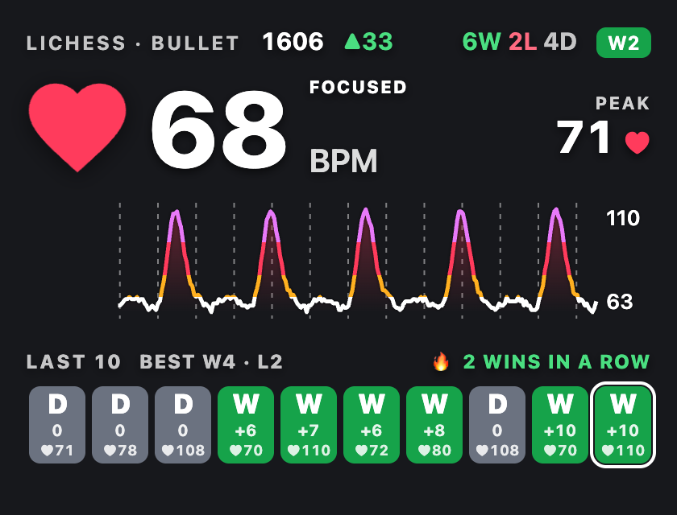
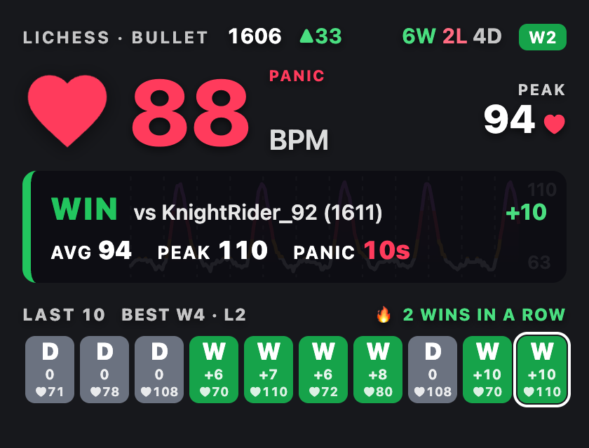
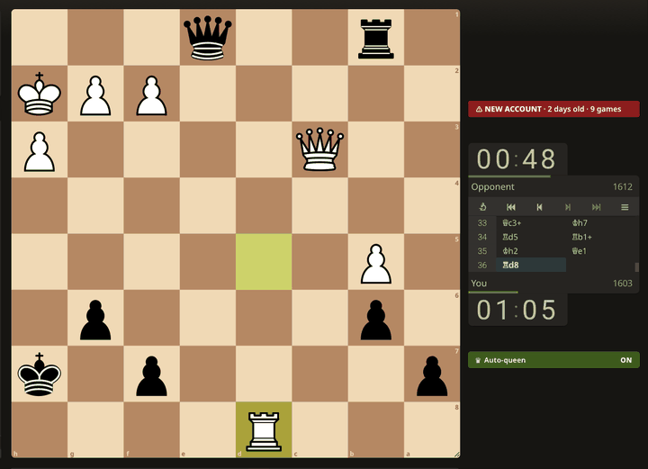

# Chess Stuff

Random collection of scripts and other stuff, mostly for streaming bullet chess.

**Website:** [chess.tomdiethe.com](https://chess.tomdiethe.com)

| Folder | What it is |
| --- | --- |
| [`hr-overlay/`](hr-overlay) | Heart-rate overlay for OBS, with a lichess / chess.com scoreboard |
| [`lichess-desk/`](lichess-desk) | Lichess Desk: a small Mac app around lichess.org, made for streaming |
| [`userscripts/`](userscripts) | Tampermonkey scripts: board tint as your clock runs down, auto-queen |

## Heart-rate overlay — `hr-overlay/`




Reads heart rate from a watch that broadcasts over Bluetooth (e.g. a Garmin Fenix with
*Broadcast Heart Rate* on) and serves an OBS Browser Source at `http://127.0.0.1:8765/`.
If you play lichess in [Lichess Desk](#lichess-desk--lichess-desk), the app does all of this
itself (**Heart Rate** menu), with no Python needed. Use the script below for chess.com or
for playing in a browser.

- big BPM with zone colour and label, spike flash, per-game peak
- 5-minute trace with game markers
- lichess / chess.com session scoreboard (rating change, W/L/D, streak)
- last 10 games as tiles (result, rating change, HR peak) plus best streaks
- post-game card: average, peak and time spent in the panic zone

```bash
uv run hr-overlay/hr_overlay.py --name fenix --lichess <user>   # or --chesscom <user>, or both
uv run hr-overlay/hr_overlay.py --demo                          # fake data, no watch needed
uv run hr-overlay/hr_overlay.py --scan                          # list nearby Bluetooth devices
```

In OBS add a Browser Source pointing at `http://127.0.0.1:8765/`, size **420 × 320**.
The port never changes; starting a new copy takes over from an old one.
Zones live in `hr-overlay/zones.toml` and reload live when you save it.
`http://127.0.0.1:8765/hr.txt` gives the plain number for a Text source.
Needs [uv](https://docs.astral.sh/uv/); it installs the one dependency (`bleak`) itself.

## Lichess Desk — `lichess-desk/`



<sub>Sped up and staged: the last minute of your clock, player names replaced.</sub>

Installs with [Homebrew](https://brew.sh). If you don't have it yet, the one-line install
command is on [brew.sh](https://brew.sh); then:

```bash
brew tap tdiethe/tap
brew trust tdiethe/tap     # Homebrew asks you to trust third-party taps
brew install --cask lichess-desk
```

Releases are signed with a Developer ID and notarised by Apple, so it opens like any other app.

A native Mac app around lichess.org (Apple Silicon and Intel, macOS 13.3+):

- full desktop site (right-drag arrows, premoves, keyboard moves), stays logged in
- fixed window title and size presets (View menu), so OBS Window Capture never needs redoing
- board tint and auto-queen built in, with settings in the **Tint** and **Play** menus
- Auto-queen button under your clock; hold ⌥ while promoting to pick another piece
- opponent account age above their clock: red and flashing for brand-new accounts
  (under 14 days or 30 games), amber for young ones, so you can spot smurfs and abort in time
- heart rate built in (**Heart Rate** menu): connects to your watch over Bluetooth, shows your
  BPM next to your clock, and serves the [heart-rate overlay](#heart-rate-overlay--hr-overlay)
  for OBS at `http://127.0.0.1:8765/`, following your lichess games for the scoreboard,
  peaks and post-game card. Pick your watch under **Heart Rate → Watch**; **Demo Heart Rate**
  lets you set up OBS without one. Zones: **Heart Rate → Edit Heart-Rate Zones…**
  (same format as `zones.toml`). Quit the Python bridge first, since both use port 8765.

```bash
lichess-desk/build.sh            # builds lichess-desk/build/Lichess Desk.app
lichess-desk/build.sh --install  # and copies it to ~/Applications
lichess-desk/release.sh 1.0.1    # signs, notarises and publishes a release to the Homebrew tap
```

One-time setup for `release.sh`:

1. A **Developer ID Application** certificate: Xcode → Settings → Accounts → your team →
   Manage Certificates → + → Developer ID Application.
2. Notary credentials saved in the keychain (uses an app-specific password from
   [account.apple.com](https://account.apple.com) → Sign-In and Security → App-Specific Passwords):

   ```bash
   xcrun notarytool store-credentials lichess-desk --apple-id <your Apple ID> --team-id <team ID>
   ```

Needs the Xcode command-line tools (`swiftc`). Not affiliated with lichess.org.

## Userscripts — `userscripts/`

Open a script's **Raw** view on GitHub and Tampermonkey offers to install it (and keeps it updated).

- `clock-board-tint.user.js`: tints the board yellow → amber → orange → red as **your**
  clock runs down, pulses in the last seconds and fades after the game. Optional auto-queen
  with a button under your clock (set `AUTO_QUEEN: true`). Works on lichess and chess.com.
  On lichess it also shows the opponent's account age above their clock (`OPP_AGE`).
  Lichess Desk bundles this file.
- `auto-queen-toggle.user.js`: standalone auto-queen toggle (Alt+Q, hold Shift to choose).
  Don't run it alongside the auto-queen in `clock-board-tint.user.js`.
